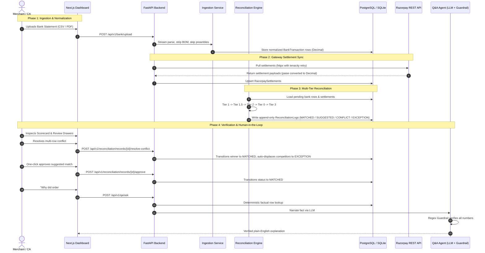
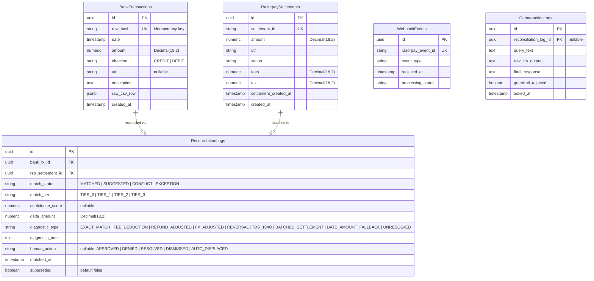

# 🏗️ Architecture — ReconGrid AI

> **Stack:** Python 3.11+ / FastAPI / Pydantic v2 / SQLAlchemy (async) / PostgreSQL  
> **Frontend:** Next.js 14 / React 18 / Tailwind CSS / TypeScript  
> **Razorpay:** Called via `httpx` against the REST API — no Node SDK

---

## 1. How Data Flows Through the System

When a merchant uploads a bank statement or Razorpay fires a settlement webhook, here is the exact sequence of events:

---

## 2. Components — What Each Piece Does

### 2.1 Ingestion Service — [`backend/app/services/ingestion.py`](./backend/app/services/ingestion.py)
*Coordinated with [`backend/app/utils/csv_parser.py`](./backend/app/utils/csv_parser.py) and [`backend/app/utils/pdf_parser.py`](./backend/app/utils/pdf_parser.py)*

**Core Responsibility:** Transform raw, messy bank files into clean, deduplicated database records.

What it does:
- **Streams** files row-by-row (bounded memory; never buffers the whole file into RAM).
- **Auto-detects dialects and preambles:** Strips bank summary headers commonly found in SBI, HDFC, and ICICI exports.
- **Normalizes** amounts to Python `Decimal(18, 2)` and cleans Indian numbering formats (e.g., `1,25,000.50` with commas and `₹` symbols).
- **Deduplicates** via a SHA-256 hash of `date|amount|utr|raw_row` — uploading the same statement twice is idempotent and safe.
- **Extracts embedded UTRs:** Scans narration strings for standard 12-to-22 character alphanumeric bank reference codes.

### 2.2 Razorpay Fetcher — [`backend/app/services/razorpay_client.py`](./backend/app/services/razorpay_client.py)

**Core Responsibility:** Synchronize settlements, payments, and refunds from Razorpay's REST API and webhooks without data loss.

What it does:
- **Cursor pagination:** Fetches settlements and refunds via `GET /v1/settlements` in batches of 100 until exhausted.
- **Exponential backoff:** Uses `tenacity` retry with jitter. Ceilings at **5 attempts** before raising `RazorpayFetchExhausted` to avoid endless retry loops on bad credentials.
- **Paise to Rupee conversion:** Converts Razorpay integer paise amounts to `Decimal` rupees (`amount / Decimal(100)`).
- **HMAC Webhook verification:** Validates `X-Razorpay-Signature` against the raw request body using constant-time `hmac.compare_digest` before parsing any JSON payload. Invalid signatures receive immediate HTTP 400 rejection.
- **Event idempotency:** Enforces unique constraint on `event_id` to guarantee duplicate webhook deliveries have no side effects.

### 2.3 Multi-Tier Reconciliation Engine — [`backend/app/services/reconciliation.py`](./backend/app/services/reconciliation.py)

**Core Responsibility:** Match bank records to gateway settlements with mathematical precision. **Zero AI is used in this decision path.**

The matching runs sequentially from strongest to weakest evidence:

| Tier | Matching Criteria | Result Status | Confidence | Human Action Needed? |
|---|---|---|---|---|
| **Tier 1** (Exact) | Exact UTR match AND exact net amount match | `MATCHED` | 100% | No — auto-verified |
| **Tier 1.5** (Normalized UTR) | UTR match after stripping bank prefix/suffix tokens (entropy ≥ 6 chars) | `SUGGESTED` | 98% | Yes — CA one-click review |
| **Tier 2** (Fuzzy Narration) | Levenshtein/token similarity $\ge 90\%$ on description text | `SUGGESTED` | 90% | Yes — CA review |
| **Tier 0** (Date Fallback) | Exact amount match within $\pm 3$ day settlement window (for rows without UTR) | `SUGGESTED` | 75% | Yes — CA approval |
| **Tier 3** (Delta Diagnostics) | Explains difference using exact formulas: 2% MDR + 18% GST, 1% Section 194-O TDS, or refunds | `MATCHED` with diagnostic | 95% | Flagged in audit ledger |
| **Tier 3b** (Subset-Sum) | Bounded combination scan for batched payouts | `MATCHED` | 92% | Grouped in audit ledger |
| **Unresolved** | Any difference that does not match known formulas or tolerance | `EXCEPTION` | 0% | Yes — flagged for forensic review |

#### Conflict Resolution & Automated Competitor Displacement:
When multiple bank transactions match the same Razorpay settlement, all candidates are locked as `CONFLICT`. When a human reviewer confirms the correct match on Bank Row A:
1. Bank Row A transitions to `MATCHED` (`human_action = "APPROVED"`).
2. Competing candidate Bank Rows B...N are automatically unlocked and transitioned to `EXCEPTION` with `human_action = "AUTO_DISPLACED"`.
3. This eliminates double-counting while preserving an immutable record of why the competitor was displaced.

### 2.4 Settlement Q&A Agent — [`backend/app/services/settlement_qa.py`](./backend/app/services/settlement_qa.py)
*Protected by [`backend/app/services/guardrail.py`](./backend/app/services/guardrail.py)*

**Core Responsibility:** Allow finance teams to ask questions about reconciliation facts in natural language without risk of financial hallucination.

1. **Deterministic Retrieval:** When the user asks *"Why did order #4521 settle with a ₹336 delta?"*, the engine performs an exact database query for order `#4521`.
2. **Constrained Prompting:** The pre-computed audit facts (fees, GST, TDS, delta amounts) are passed to the LLM (NVIDIA NIM / LLaMA 3.3 70B) with strict instructions to explain the numbers without inventing or recalculating them.
3. **Anti-Hallucination Regex Guardrail:** Every numeric token in the generated response is extracted and verified against the source record. If a single unverified number is found, the generated text is immediately dropped and replaced with a structured database fact template.
4. **Permanent Audit Logging:** Every Q&A question, the raw LLM output, and the guardrail verification status are written to `QaInteractionLogs`.

### 2.5 Audit Log Model — [`backend/app/models/reconciliation_log.py`](./backend/app/models/reconciliation_log.py)

**Core Invariant:** All reconciliation logs are **append-only**. Records are marked `superseded=True` if updated by human action, never deleted. The database maintains full row conservation:

$$\sum (\text{MATCHED} + \text{SUGGESTED} + \text{CONFLICT} + \text{EXCEPTION} + \text{PENDING}) = \text{Total Ingested Rows}$$

### 2.6 Frontend Dashboard — [`frontend/src/app/page.tsx`](./frontend/src/app/page.tsx)

Built with Next.js 14 and Tailwind CSS:
- Real-time KPI summary cards (match rate %, total ₹ reconciled, total unresolved deltas).
- Tabular reconciliation ledger with color-coded status badges.
- One-click approval drawer for `SUGGESTED` matches.
- Interactive multi-row conflict resolution drawer.
- Forensic audit drawer showing raw bank CSV row side-by-side with Razorpay JSON payload.
- Slide-out Settlement Q&A panel.

---

## 3. Database Schema

---

## 4. Security Boundaries

| What | How It's Protected |
|---|---|
| Razorpay secrets | Backend `.env` only — never referenced in frontend |
| Webhook verification | HMAC-SHA256 on raw bytes, `hmac.compare_digest` (constant-time), runs before route body parsing |
| Duplicate webhooks | Deduped by `event.id` unique constraint |
| CSV injection | MIME/size validated before parsing, no `eval`, streamed with bounded memory |
| Money precision | `Decimal`-only via Pydantic `condecimal` — floats rejected at the schema boundary |
| LLM output | Guardrailed against source row — invented numbers are rejected, interaction logged |

---

## 5. Rate Limiting, Pagination & Failure Recovery

- **Pagination:** Cursor/offset loop (`count=100, skip=N`) until no more results
- **Backoff:** `tenacity` exponential backoff + jitter on `429`/`5xx`, max 5 attempts, then hard-stop with `RazorpayFetchExhausted`
- **Concurrency throttle:** `asyncio.Semaphore` limits parallel Razorpay calls to avoid quota exhaustion
- **Circuit breaker:** After N consecutive failures, jobs pause for a cooldown before retrying

---

## 6. API Endpoints

All routes are under `/api/v1` — see the [complete API Reference in the README](./README.md#api-endpoints).

---

## 7. Edge Cases Explicitly Handled

1. **Split/batched settlements** — Tier 3 groups settlements by date window and compares summed amounts before declaring `EXCEPTION`.
2. **Missing/non-standard UTR** — Tier 0 fallback engages automatically with timezone-normalized comparisons; result is always `SUGGESTED`, never auto-`MATCHED` (weaker evidence).
3. **Duplicate/out-of-order webhooks** — Deduped by `event_id`; matching logic handles settlements arriving before bank data (creates `PENDING_BANK_DATA` state, not a false exception).
4. **Multi-Candidate Conflict Locking & Displacement** — If multiple bank statement lines share a settlement reference or UTR, all entries are locked as `CONFLICT`. Assigning the settlement to one row automatically displaces and unlinks competing rows to `EXCEPTION` (`AUTO_DISPLACED`), preventing double-credit.
5. **Section 194-O E-Commerce TDS & 2% MDR + 18% GST** — Evaluates standard statutory withholding and payment aggregator fee deductions before marking records unresolved.
