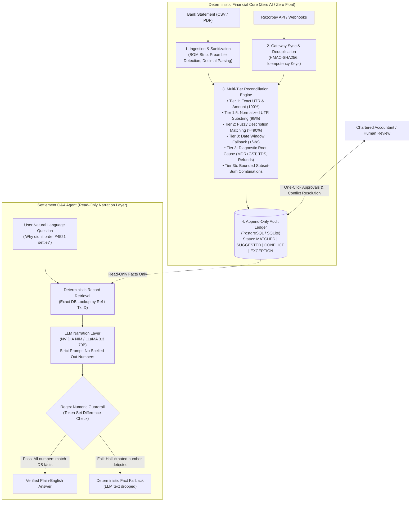

# Project Overview — ReconGrid AI

## 1. What Is ReconGrid AI?

**ReconGrid AI** is an open-source settlement reconciliation and discrepancy-diagnostic engine designed for Indian businesses and finance teams accepting payments via Razorpay.

When you run a reconciliation batch, the engine produces three verifiable outputs:
1. **Automated Match Rate %** — the exact proportion of records reconciled automatically without human intervention.
2. **Total ₹ Reconciled with Complete Row Conservation** — every single paisa is accounted for. $\sum(\text{matched} + \text{suggested} + \text{exceptions} + \text{pending}) = \text{total ingested}$.
3. **An Unedited Exception Ledger** — every single row that could not be matched with 100% certainty is preserved verbatim with an audit reason code.

> **Core Philosophy:** This is an audit tool first. Mathematical reconciliation is 100% deterministic code. Generative AI is used strictly for read-only natural language explanations backed by a regex-based anti-hallucination guardrail.

---

## 2. Why Reconciliation Breaks in the Real World

If you sell products or services online in India, your bank balance never matches your gross payment gateway report. A typical month-end disconnect looks like this:

### A Real-World Example: The ₹10,000 Order

Suppose a customer pays ₹10,000 for an order on your website:

```
+ Customer Pays via Razorpay:                 ₹ 10,000.00
- Gateway MDR Fee (2.0%):                     -   ₹ 200.00
- 18% GST on MDR Fee (18% of ₹200):           -    ₹ 36.00
- Statutory TDS (Section 194-O, 1% of gross): -   ₹ 100.00
----------------------------------------------------------
= Net Settlement Expected in Bank:             ₹ 9,664.00
```

When this settles into your bank account, you don't receive ₹10,000. You receive ₹9,664.

### Where Manual Excel Workflows Collapse:
* **Batched Payouts:** Razorpay does not send individual payments one by one. It groups 50 to 500 payments into a single bulk transfer (e.g., ₹4,83,200.00). If two orders in that batch had customer refunds deducted, Excel `VLOOKUP` fails completely.
* **Messy Bank Formats:** SBI exports multi-line header preambles; HDFC includes encrypted PDFs; ICICI buries the 12-digit UTR in an 80-character narration string (`CMS/CMS2847192847/RZP/NET`).
* **Silent Dropping:** When overwhelmed finance teams force numbers to balance in spreadsheets, unresolved exceptions are often swept into a generic "Miscellaneous Suspense" bucket, obscuring theft, double fees, or gateway leakage.

---

## 3. How ReconGrid AI Solves It

ReconGrid AI maintains a hard architectural boundary: **Deterministic code makes every financial decision. AI is strictly a read-only narration layer.**



### The 4 Status States of Every Transaction:

1. **`MATCHED`**: 100% verified by Tier 1. Exact UTR and net amount match perfectly. Zero human action required.
2. **`SUGGESTED`**: Strong mathematical correlation found (e.g. normalized UTR substring, or exact amount within a 3-day window, or fee delta explained). Placed in the CA review queue for one-click confirmation.
3. **`CONFLICT`**: Two or more bank rows claim the same Razorpay settlement (or vice versa). Both rows are locked until a human reviewer assigns the settlement to the correct row. When approved, the competing candidate is displaced to `EXCEPTION`.
4. **`EXCEPTION`**: Unresolved rows with specific diagnostic reason codes (`FEE_DEDUCTION`, `REFUND_ADJUSTED`, `TDS_194O_DEDUCTION`, `UNRESOLVED`). These remain in the permanent ledger for tax audits.

---

## 4. Why We Reject IEEE 754 Floating-Point Numbers

In standard Python:
```python
>>> 0.1 + 0.2
0.30000000000000004
```

In casual software, an extra `0.00000000000000004` is harmless. In financial accounting across 100,000 transactions, binary floating-point drift creates ghost pennies that violate statutory tax filings and fail bank reconciliation audits.

**ReconGrid AI enforces a Zero-Float Policy:**
- All money attributes use Python's standard library `Decimal` with explicit `ROUND_HALF_UP` precision: `Decimal('10000.00')`.
- Pydantic v2 schemas reject any incoming payload with floating-point values at the boundary (`backend/tests/unit/test_schema_float_rejection.py`).
- Amounts from Razorpay API (reported in integer paise) are converted via integer division: `Decimal(paise_amount) / Decimal(100)`.

---

## 5. When the System Stops & Asks a Human

The engine never guesses. It automatically pauses and routes a transaction to the human review drawer whenever:
* An amount difference cannot be accounted for by standard formulas (2% MDR + 18% GST, 1% TDS, or documented refunds) within a ±₹1.00 rounding tolerance.
* A fuzzy narration score is below the 90% confidence threshold.
* Two transactions compete for the same settlement ID.
* A webhook signature fails HMAC-SHA256 verification.
* Razorpay API rate limits or connection retries exceed 5 attempts.

---

## 6. Real-World Edge Cases Handled

1. **Batched Settlements (Subset-Sum):** A single bank credit of ₹48,200.00 may represent three separate sales batches settled together. The Tier 3b bounded subset-sum scan tests combinations of pending settlements within a ±3-day window to locate exact aggregate matches without exponential CPU blowup.
2. **Settlement Reversals & Chargebacks:** If a customer dispute results in a clawback days after settlement, the bank statement shows a `DEBIT`, not a `CREDIT`. Ingestion maintains strict credit/debit sign awareness.
3. **Messy Indian Bank CSV Preambles:** SBI, ICICI, and HDFC prepend bank account summaries, IFSC codes, and empty lines before the actual CSV table. The ingestion parser automatically scans rows until it detects canonical header columns (`Date`, `Narration`, `Withdrawal`, `Deposit`).
4. **Encrypted Bank PDFs:** Bank statements downloaded by merchants often have passwords (e.g. DOB + PAN or mobile number). The PDF processor accepts passwords and provides per-bank format hints.

---

## 7. Performance Benchmarks

Measured on standard hardware with full database writes and audit logging enabled (`python backend/scripts/benchmark_throughput.py`):

| Batch Size | Execution Time | Throughput | Peak RAM | Match Rate % | Unresolved Exceptions (INR) | Conservation |
|:---:|:---:|:---:|:---:|:---:|:---:|:---:|
| **50** | `0.0351s` | **1,424 rows/s** | 1.5 MB | 96.00% | 2 (₹ 99,998.00) | PASSED (0 lost) |
| **200** | `0.1078s` | **1,855 rows/s** | 2.7 MB | 95.00% | 10 (₹ 499,990.00) | PASSED (0 lost) |
| **500** | `0.3136s` | **1,594 rows/s** | 6.5 MB | 94.80% | 9 (₹ 449,991.00) | PASSED (0 lost) |
| **1,000** | `0.9716s` | **1,029 rows/s** | 12.9 MB | 94.80% | 17 (₹ 849,983.00) | PASSED (0 lost) |
| **5,000** | `32.6310s` | **153 rows/s** | 67.5 MB | 94.72% | 13 (₹ 649,987.00) | PASSED (0 lost) |

---

## 8. Out of Scope for v1 (Keeping It Honest)

To maintain clean engineering boundaries:
- **Multi-bank netting:** We reconcile statements one bank account at a time. Multi-account cross-netting is out of scope.
- **Direct Tax Filing:** We compute GST Input Tax Credit (ITC) deltas and TDS breakdowns, but we do not submit directly to the GSTN or TRACES portals.
- **Cardholder PCI Data:** ReconGrid only processes settlement metadata (amounts, UTRs, dates). It never handles credit card numbers, CVVs, or cardholder credentials. PCI-DSS compliance is not required.
